<!--
  Generated by scripts/build_profile.py from profile.toml — edit those, not this file.
  Refreshed weekly by .github/workflows/update-profile.yml.
-->

<picture>
  <source media="(prefers-color-scheme: dark)" srcset="assets/terminal-dark.svg">
  <source media="(prefers-color-scheme: light)" srcset="assets/terminal-light.svg">
  
</picture>

<picture>
  <source media="(prefers-color-scheme: dark)" srcset="assets/stats-dark.svg">
  <source media="(prefers-color-scheme: light)" srcset="assets/stats-light.svg">
  
</picture>

<b>About Me</b> (plain text)

- CS Student @ **CSP (HSGS, HNUE) ’22–’25** → **VNU-UET ’25-’26 → NTUsg ’26-?**
- AI Researcher/Engineer (speedrun any%) @ [**OpenPrism-Labs**](https://github.com/OpenPrism-Labs)
- Competitive Programmer (Codeforces, AtCoder, DMOJ) (Used to be, gave up)
- Interested in AI, systems, design, and 3D art

## Links
- Profile: [normankr07.carrd.co](https://normankr07.carrd.co/)
- Discord: [@normankr07](https://discord.com/users/757131630811938926)
- Codeforces: [TheMiraiTraveller0711](https://codeforces.com/profile/TheMiraiTraveller0711)
- AtCoder: [normankr07](https://atcoder.jp/users/normankr07)
- DMOJ: [normankr07](https://www.dmoj.ca/user/normankr07)

Stats last refreshed 2026-10-17 · rebuilt weekly by GitHub Actions
